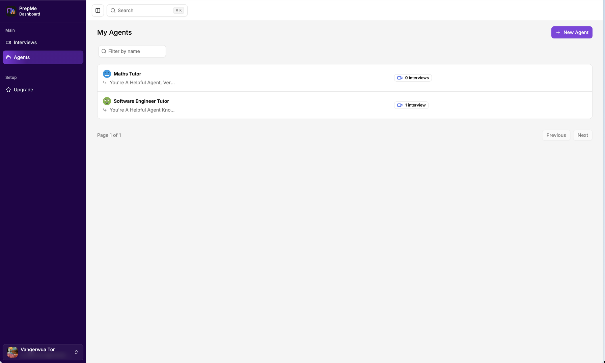
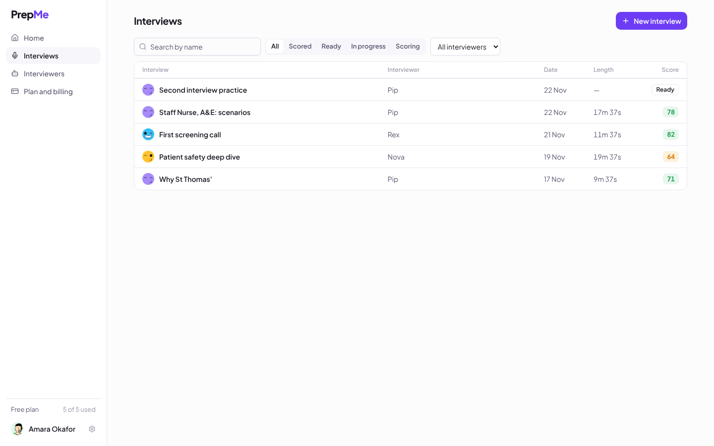
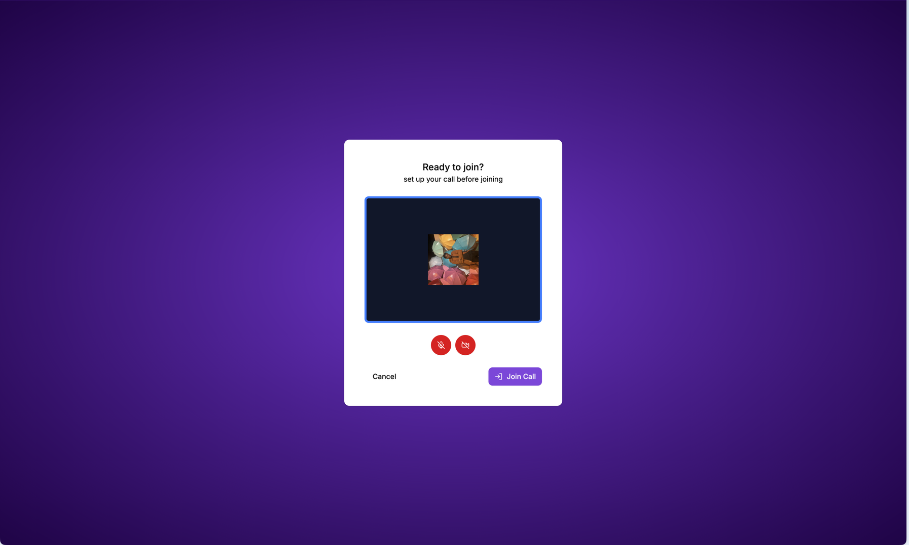
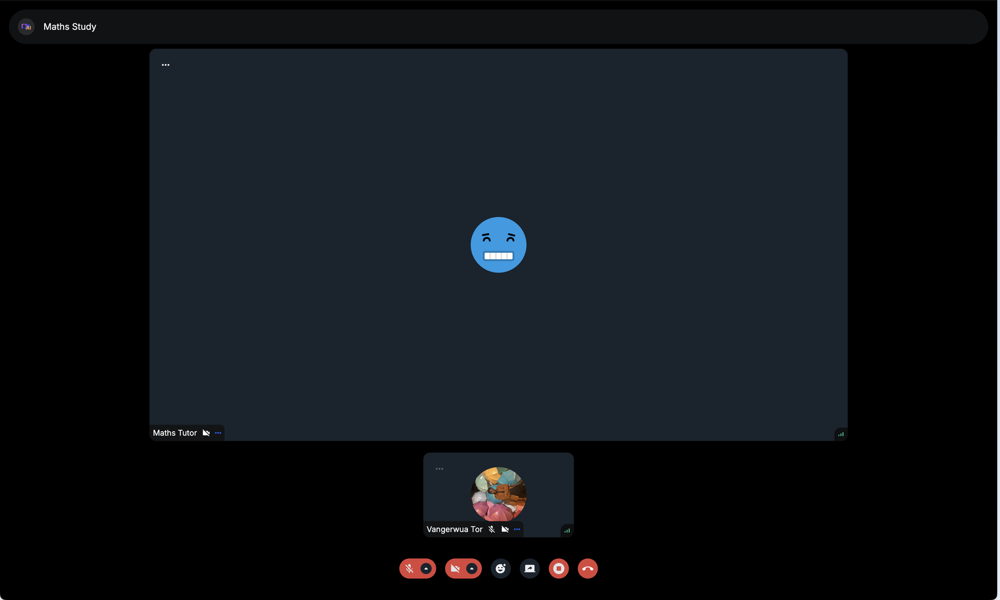

# PrepMe

Practise job interviews out loud. Pick an interviewer, paste the job description, and have a real-time voice interview in your browser. When you hang up, PrepMe scores every answer, writes a stronger version of each one, and lets you ask a coach follow-up questions.

**Live:** [prepme-ai.vercel.app](https://prepme-ai.vercel.app)


| Your interviewers | Your interviews |
| --- | --- |
|  |  |
| **Pre-call check** | **Live call with the AI interviewer** |
|  |  |

## How it works

```
 browser ──WebRTC audio──► OpenAI Realtime (gpt-realtime-mini)
    │  ▲                         ▲
    │  └── ephemeral key ────────┤  POST /api/interviews/:id/session
    │                            │  (server mints a 2-minute client secret)
    │
    ├── transcript autosave ──► POST /api/interviews/:id/transcript   (debounced + sendBeacon on close)
    ├── hang up ─────────────► POST /api/interviews/:id/complete      → status "processing"
    │                                   └─► scorecard via Responses API + Zod structured output
    └── coach chat ──────────► POST /api/interviews/:id/chat          (streamed, stored in Postgres)
```

- **Nothing long-running lives in a serverless function.** The browser talks to OpenAI directly with a short-lived key, so a Vercel function freezing or timing out can no longer end the call. (That was the cause of the old "the interview stops abruptly" bug.)
- **Survives a bad connection.** The transcript is saved while you talk. If the line drops, the call reconnects up to three times and the interviewer picks up where it left off, using the transcript so far.
- **Time-boxed like a real interview.** The interviewer is told when two minutes are left, wraps up, and asks if you have questions.
- **Structured scorecard.** Overall score, verdict, five competencies with evidence, per-question feedback with a stronger answer, and what to practise next.

## Stack

SvelteKit 2 + Svelte 5 · TypeScript · Tailwind CSS 4 · bits-ui · OpenAI (Realtime + Responses) · Drizzle ORM on Postgres (Neon) · Better Auth · Polar · Vercel (Node 24)

## Getting started

```sh
bun install            # or npm install
cp .env.example .env   # fill in DATABASE_URL, BETTER_AUTH_SECRET, OPENAI_API_KEY
bun run db:push        # create or update tables
bun run dev
```

All settings are documented in [.env.example](./.env.example). Social sign-in and Polar billing are optional: they only switch on when their keys are set. Model names can be changed through env vars without a code change.

### Scripts

| Script | What it does |
| --- | --- |
| `dev` / `build` / `preview` | Vite dev server, production build, preview |
| `check` | `svelte-check` type check |
| `test` | Vitest unit tests |
| `db:push` / `db:generate` / `db:migrate` / `db:studio` | Drizzle Kit |

## Upgrading from v1

v2 drops Stream Video/Chat, Inngest and the webhook pipeline. Run `db:push` once: it adds new columns (`transcript`, `scorecard`, `job_description`, …) and the `interview_messages` table. Old interviews are kept and show their original summary. The Stream, Inngest and old OpenAI webhook env vars can be removed from Vercel.
