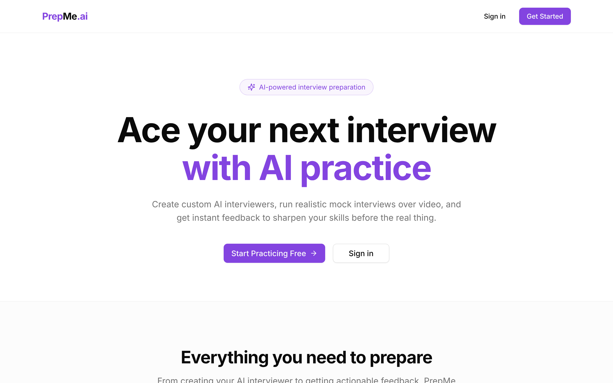
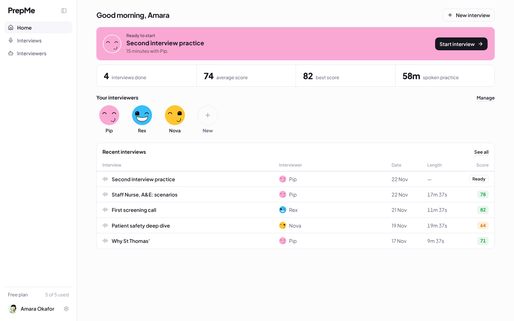
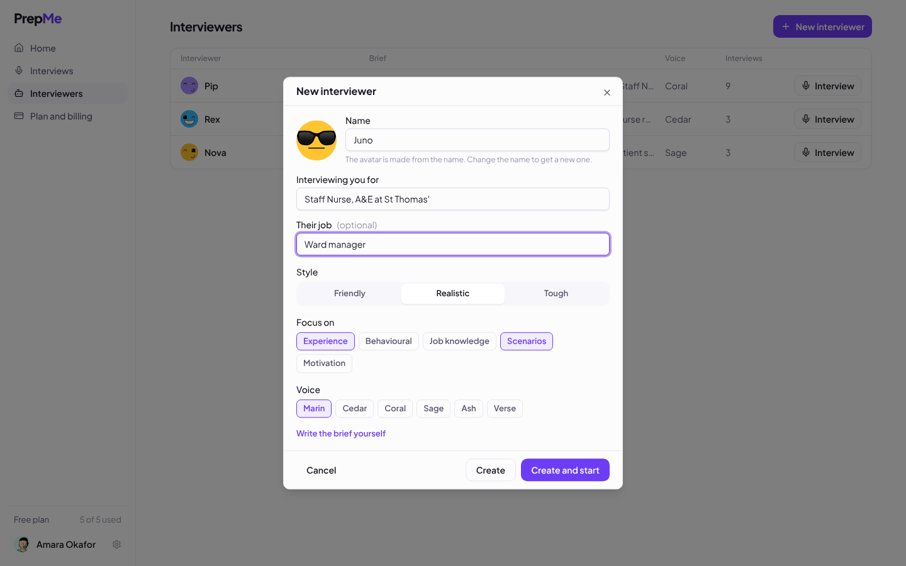
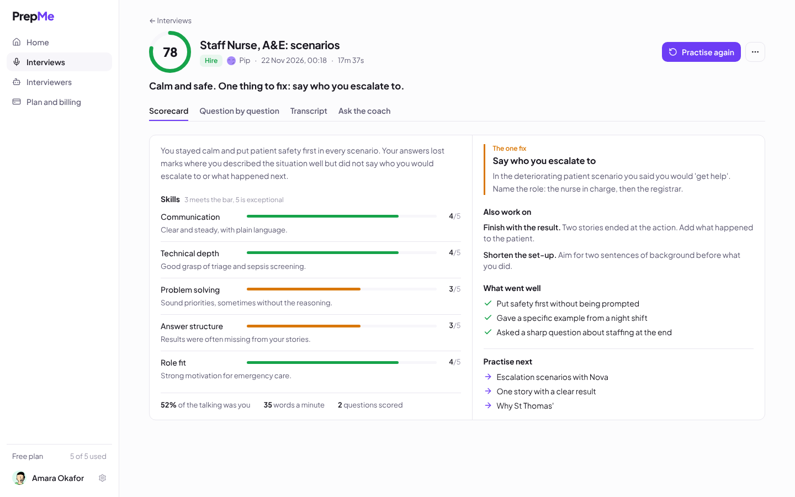

# PrepMe

Practise job interviews out loud. Pick an interviewer, paste the job description, and have a real-time voice interview in your browser. When you hang up, PrepMe scores every answer, writes a stronger version of each one, and lets you ask a coach follow-up questions.

**Live:** [prepme.stbrn.studio](https://prepme.stbrn.studio)



| Home | New interviewer |
| --- | --- |
|  |  |
|  |  |
|  |  |

## How it works

```
 browser ──WebRTC audio──► OpenAI Realtime (gpt-realtime-2.1-mini)
    │  ▲                         ▲
    │  └── ephemeral key ────────┤  POST /api/interviews/:id/session
    │                            │  (server mints a 2-minute client secret)
    │
    ├── transcript autosave ──► POST /api/interviews/:id/transcript   (debounced + sendBeacon on close)
    ├── hang up ─────────────► POST /api/interviews/:id/complete      → status "processing"
    │                                   └─► scorecard via Responses API + Zod structured output
    └── coach chat ──────────► POST /api/interviews/:id/chat          (streamed, stored in D1)
```

- **Nothing long-running lives on the server.** The browser talks to OpenAI directly with a short-lived key, so a server function freezing or timing out can no longer end the call. (That was the cause of the old "the interview stops abruptly" bug.)
- **Survives a bad connection.** The transcript is saved while you talk. If the line drops, the call reconnects up to three times and the interviewer picks up where it left off, using the transcript so far.
- **Time-boxed like a real interview.** The interviewer is told when two minutes are left, wraps up, and asks if you have questions.
- **Structured scorecard.** Overall score, verdict, five competencies with evidence, per-question feedback with a stronger answer, and what to practise next.

## Stack

SvelteKit 2 + Svelte 5 · TypeScript · Tailwind CSS 4 · bits-ui · OpenAI (Realtime + Responses) · Better Auth · Polar · Drizzle ORM

Everything runs on Cloudflare:

| Piece | Cloudflare product |
| --- | --- |
| App (pages + API) | Workers, with static assets (`@sveltejs/adapter-cloudflare` 7.x, the last line for SvelteKit 2) |
| Database | D1 (`DB` binding), migrations in `./drizzle` |
| Scoring and coach chat traffic | AI Gateway, optional (`OPENAI_BASE_URL`) for logs, caching and spend limits |
| Domain | `prepme.stbrn.studio` custom domain in `wrangler.jsonc` |

## Getting started

```sh
bun install
cp .dev.vars.example .dev.vars   # fill in BETTER_AUTH_SECRET and OPENAI_API_KEY
bun run db:migrate:local          # create tables in the local D1 database
bun run dev
```

`bun run dev` runs Vite with Wrangler's local bindings, so D1 is a local SQLite file under `.wrangler/state`. Model names and other non-secret settings are `vars` in [wrangler.jsonc](./wrangler.jsonc); secrets go in `.dev.vars` locally and in the Worker's settings in production.

### Deploying

1. Set secrets once: `bunx wrangler secret put BETTER_AUTH_SECRET`, then `OPENAI_API_KEY`, and optionally `POLAR_ACCESS_TOKEN` and the social sign-in secrets.
2. `bun run deploy` builds, applies any new D1 migrations, and deploys the Worker.

Or connect the repository in the Cloudflare dashboard (Workers Builds) with build command `bun run build` and deploy command `bunx wrangler d1 migrations apply prepme --remote && bunx wrangler deploy`, so every push to `main` deploys and branches get preview URLs.

### What interviews cost

Every interview records what it used at OpenAI (voice, live transcript, scoring and coach chat) in the `usage_events` table, priced with the table in [src/lib/usage.ts](./src/lib/usage.ts). The voice figures are read from OpenAI's own events in the browser, so they are for working out costs, not for billing.

- **Cost page.** `/dashboard/costs` shows the cost per interview and per voice minute, where the money goes, and what the planned plans would cost. Only the accounts listed in the `ADMIN_EMAILS` secret can open it: `bunx wrangler secret put ADMIN_EMAILS` (comma-separated sign-in emails).
- **Trimming long calls.** `OPENAI_REALTIME_CONTEXT_TOKENS` in `wrangler.jsonc` is `"0"` (off). Set it to a number such as `"8000"` and OpenAI drops the oldest half of a call once it passes that many tokens, while the app reminds the interviewer which questions it already asked. Each drop makes OpenAI re-read the rest of the call at full price once, so trimming is not always cheaper: the cost page compares trimmed calls with untrimmed ones.
- **Prices.** When OpenAI changes a price or a model is swapped, update `MODEL_PRICES`. Usage for a model with no price is stored without a cost, and the cost page says so. `USD_PER_GBP` (default 1.27) sets the rate the page uses to show pounds.

### Scripts

| Script | What it does |
| --- | --- |
| `dev` / `build` / `preview` | Vite dev server, production build, build + local Worker preview |
| `deploy` | Build, migrate D1, deploy to Cloudflare |
| `check` / `test` | `svelte-check` and Vitest |
| `db:generate` | Generate a SQL migration after changing `src/lib/db/schema.ts` |
| `db:migrate:local` / `db:migrate` | Apply migrations to local / production D1 |

### Moving data from Neon

`scripts/neon-to-d1.ts` copies users, sign-in accounts, interviewers, interviews and coach messages from the old Postgres database into D1. Passwords keep working; everyone signs in once more because sessions are not copied.

```sh
DATABASE_URL=postgres://…neon… bun scripts/neon-to-d1.ts > neon-export.sql
bunx wrangler d1 execute prepme --remote --file neon-export.sql
```

## Upgrading from v1

v2 drops Stream Video/Chat, Inngest, Vercel and Neon. Copy the data with the script above; old interviews keep their original summary.
